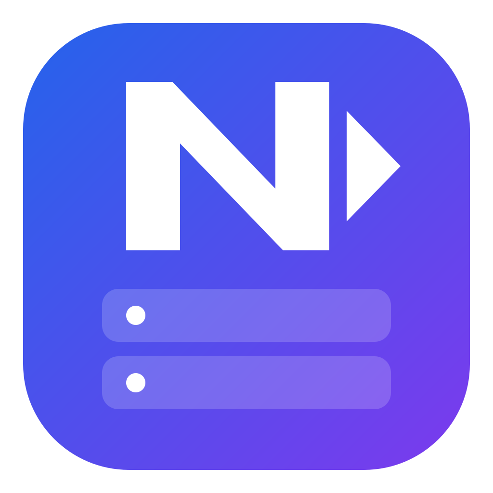

<p align="center">
	
</p>

<h1 align="center">Modrinth Next</h1>

<p align="center">
	Ein inoffizieller Fork der Modrinth App – <b>ohne Werbung</b> und mit <b>lokalen Minecraft-Servern</b>.
</p>

<p align="center">
	<a href="../../releases/latest"><b>⬇️ Neueste Version herunterladen</b></a>
</p>

> **Hinweis:** Modrinth Next ist ein Community-Projekt und steht in keiner Verbindung zu Modrinth / Rinth, Inc.
> Es basiert auf dem Open-Source-Code der [Modrinth App](https://github.com/modrinth/code) (GPL-3.0).
> Wenn dir Modrinth gefällt, unterstütze die Creator und das Team z. B. mit [Modrinth+](https://modrinth.plus).

## Features

Alles aus der Modrinth App (Instanzen, Modpacks, Mods von Modrinth, Skins …) und zusätzlich:

### 🚫 Keine Werbung

Kein Werbebanner, kein Werbe-Consent-Popup, keine Upgrade-Hinweise.

### 🖥️ Lokale Server

Ein eigener Tab, um Minecraft-Server direkt auf deinem PC zu betreiben:

- **Server mit wenigen Klicks erstellen** – Fabric, NeoForge, Forge, Paper oder Vanilla, beliebige Minecraft-Version.
  Server-Dateien und die passende Java-Version werden automatisch heruntergeladen.
- **Mods, Plugins und Datapacks von Modrinth installieren** – die Suche zeigt nur passende Inhalte,
  benötigte Abhängigkeiten werden automatisch mitinstalliert.
- **Live-Konsole** mit Befehlseingabe und Verlauf.
- **Einstellungen** wie Spielmodus, Schwierigkeit, PvP, Whitelist, Port, RAM und mehr – ohne `server.properties` von Hand zu bearbeiten.
- **Adresse zum Kopieren** für dich (`localhost`) und für Freunde im selben Netzwerk (LAN).

## Installation (Windows)

1. Lade unter [Releases](../../releases/latest) die Datei `Modrinth-Next_x.y.z_x64-setup.exe` herunter.
2. Starte sie. Da der Installer nicht signiert ist, zeigt Windows SmartScreen evtl. eine Warnung:
   „Weitere Informationen“ → „Trotzdem ausführen“.

Modrinth Next installiert sich **neben** der offiziellen Modrinth App und nutzt einen eigenen Datenordner.
Findet es beim ersten Start die offizielle Modrinth App, fragt es, ob **Profile, Mods, Einstellungen und Anmeldungen**
übernommen werden sollen. Dabei wird eine Kopie erstellt – die offizielle App bleibt unverändert.

## Selbst bauen

Voraussetzungen: [Node.js](https://nodejs.org) + [pnpm](https://pnpm.io), [Rust](https://rustup.rs),
Visual Studio C++ Build Tools (Windows) und ein JDK 17–21.

```powershell
pnpm install
Copy-Item packages/app-lib/.env.prod packages/app-lib/.env
$env:SQLX_OFFLINE = "true"
cd apps/app
pnpm tauri build --bundles nsis
```

Der Installer liegt danach in `target/release/bundle/nsis/`.

## Wo ist was?

| Bereich                              | Pfad                                            |
| ------------------------------------ | ----------------------------------------------- |
| Lokale Server – Backend (Rust/Tauri) | `apps/app/src/api/local_servers.rs`             |
| Lokale Server – Oberfläche (Vue)     | `apps/app-frontend/src/features/local-servers/` |
| Werbung deaktiviert                  | `apps/app/src/api/ads.rs` (`ADS_ENABLED`)       |

Der restliche Code entspricht dem [Modrinth-Monorepo](https://github.com/modrinth/code).

## Lizenz

Die App steht wie das Original unter der [GPL-3.0](apps/app/LICENSE). Siehe auch [COPYING.md](COPYING.md).
Modrinth-Markenzeichen und -Logos wurden entfernt bzw. ersetzt.
